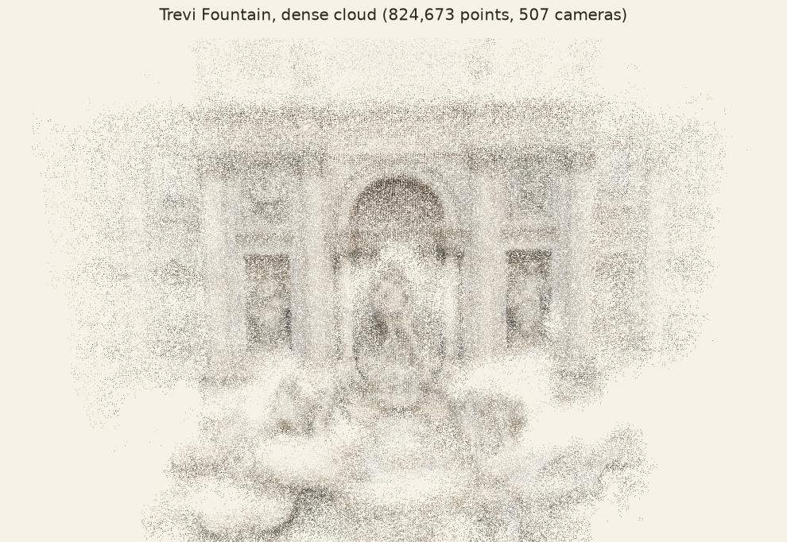
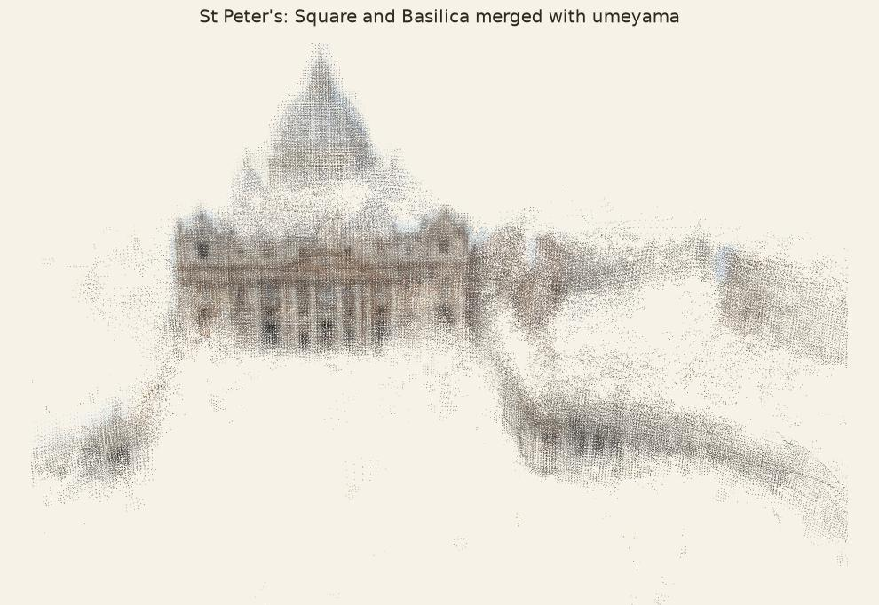
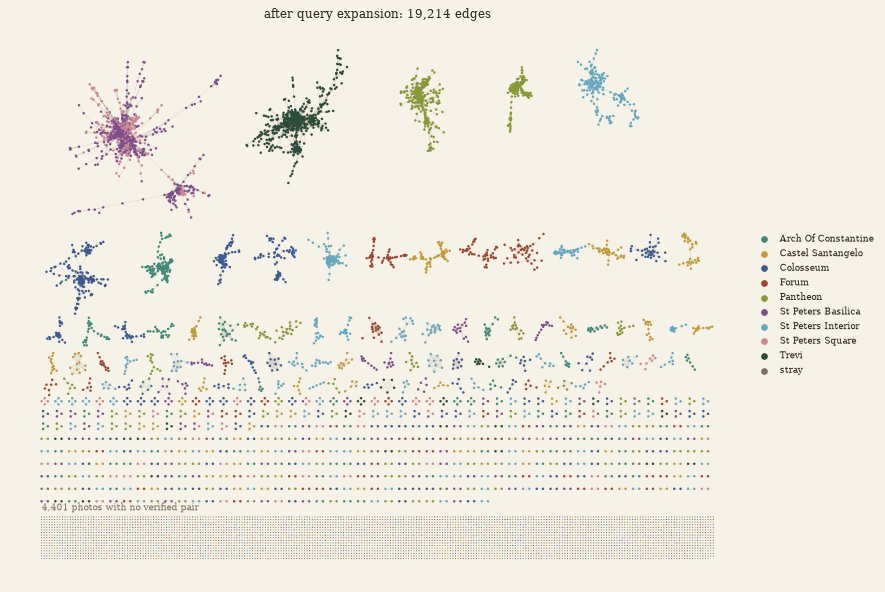
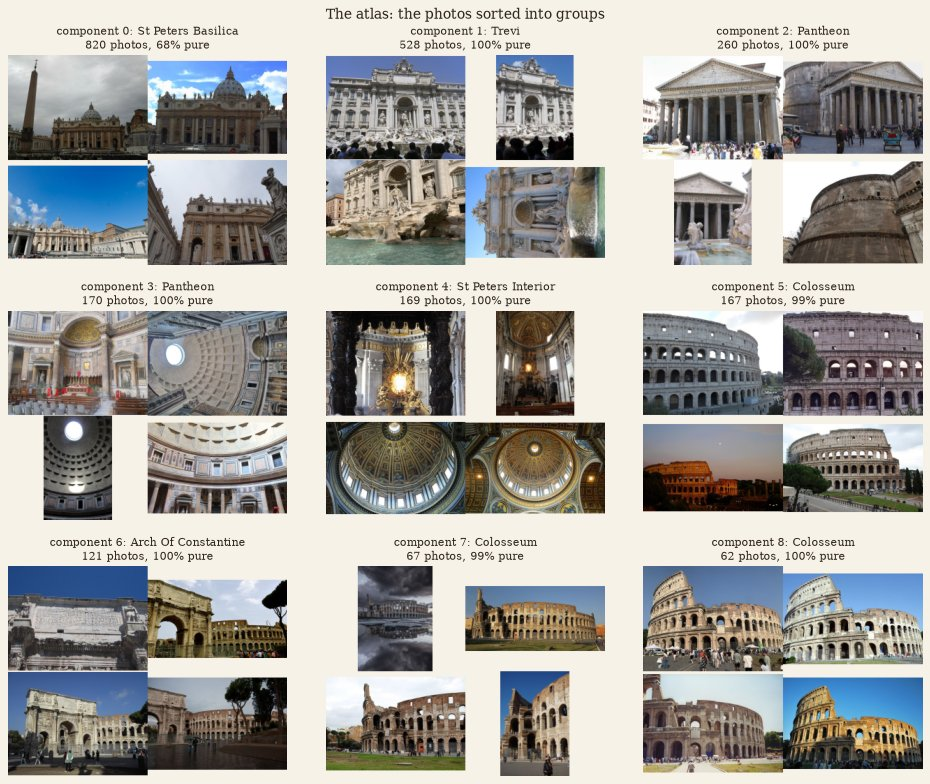
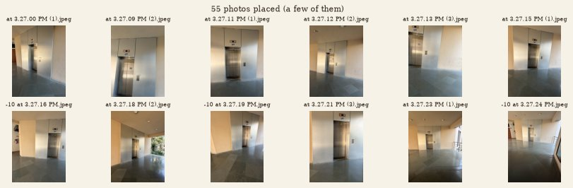
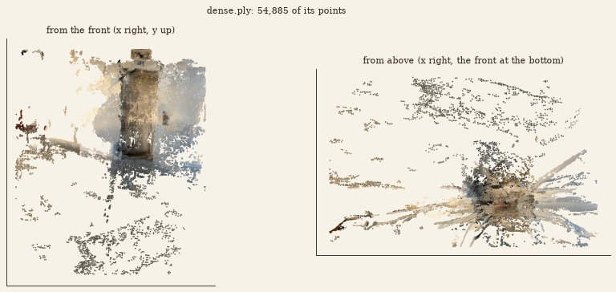

# Rome in a Day: Structure from Motion at City Scale

From a folder of 8,987 unlabelled tourist photos to 3D models of Roman landmarks, then to a 3D model of a place I
photographed myself. A small version of [*Building Rome in a Day*](https://grail.cs.washington.edu/rome/)
(Agarwal, Snavely, Simon, Seitz and Szeliski, 2009), done as the ES666 (IIT Gandhinagar) Structure from Motion
assignment.

I wrote the nine core functions of the pipeline from scratch (NumPy and SciPy, no OpenCV matchers, homography or
triangulation): image retrieval with tf-idf, descriptor matching, query expansion, connected components, the
homography DLT and the homography/fundamental ratio test, linear triangulation and the Umeyama alignment. The course
toolbox provides SIFT, RANSAC for F, PnP, bundle adjustment, the dense cloud and the plots, and calls my functions
inside them.

<p align="center">
  
  
</p>
<p align="center"><sub>Left: the Trevi Fountain, 507 of 528 photos placed, 824,673 dense points. Right: two separate
maps of St Peter's (Square and Basilica) joined into one with my <code>umeyama</code>.</sub></p>

---

## Contents

- [Results](#results)
- [The pipeline](#the-pipeline)
- [What I implemented](#what-i-implemented)
- [Repository layout](#repository-layout)
- [Setup](#setup)
- [How to run](#how-to-run)
- [Task 10: my own photos](#task-10-my-own-photos)
- [Lessons and limitations](#lessons-and-limitations)
- [References](#references)
- [Credits and licence](#credits-and-licence)

---

## Results

All numbers are from the saved run of [`rome_in_a_day.ipynb`](rome_in_a_day.ipynb) (every cell run from the top, no
errors, all 89 checks passing).

### Finding which photos belong together

| Step | Result |
|---|---|
| Collection | 8,987 photos: 6,987 of 9 Rome landmarks + 2,000 strays from other places; 7.05 M keypoints, 16,384 visual words |
| All pairs | 40,378,591 pairs: about **35 hours** to verify at the measured 3.1 ms per pair |
| Retrieval (`tfidf_matrix`, `top_k_neighbours`, k = 10) | **77,774** candidate pairs instead (0.19% of all pairs) |
| Geometric verification (RANSAC on F) | **10,816** real pairs, about 4 minutes |
| Query expansion (`query_expansion`, 2 rounds) | +5,836 and +2,562 real pairs: **19,214** edges |
| Groups (`connected_components`) | largest groups 820, 528, 260 photos; 4,401 photos left alone, 1,985 of them strays. Only 15 of the 2,000 strays ended up in a group |

<p align="center"></p>
<p align="center"><sub>The match graph after query expansion: one dot per photo, coloured by the hidden landmark label
(used only to evaluate). The landmarks separate into their own groups; the grey block at the bottom are photos with no
verified pair, mostly the strays.</sub></p>

### Building the Trevi Fountain

| Step | Result |
|---|---|
| Group | 528 photos, 3,993 verified edges; maximum spanning tree of 527 edges |
| Tracks (my `match_descriptors` on 2,128 strong pairs) | 87,879 tracks |
| Start pair (my `homography_ratio`) | lowest ratio passing every check: 292 points, all in front of both cameras, median ray angle 7.7° |
| My triangulation on that pair | median reprojection error **0.11 px** (90% under 0.40 px) |
| Skeleton (incremental SfM + bundle adjustment) | 111 photos, 14,838 points, rms 0.68 px, 140 s |
| Everyone else (PnP) | +396 photos in 54 s: **507 of 528 placed**, 59,691 points, rms 0.76 px |
| Dense cloud | **824,673** points |
| My triangulation vs the bundle-adjusted model | median gap 0.74% of the model's size |

### Aligning maps (`umeyama`)

| Test | Result |
|---|---|
| Trevi cameras vs the reference reconstruction | median camera error **3.0%** of the scene size |
| St Peter's Basilica map moved into the Square's frame | 407 shared photos as anchors, **3.2%** of the Square's size apart after the merge |

<p align="center"></p>

---

## The pipeline

<p align="center"></p>

Functions marked ★ are mine; the rest come from the course toolbox.

| # | Step | What it does | Why it is needed |
|---|---|---|---|
| 1 | SIFT + visual words | keypoints, 128-number descriptors, each snapped to one of 16,384 words | makes photos searchable and matchable |
| 2 | ★ `tfidf_matrix` | weighted word histogram per photo, rows of length 1 | rare patterns count more than common ones |
| 3 | ★ `top_k_neighbours` | 10 most similar photos per photo (cosine similarity) | avoids checking all 40 M pairs |
| 4 | ★ `match_descriptors` | nearest neighbour + Lowe's ratio test + mutual check | removes ambiguous matches |
| 5 | RANSAC on F | keeps a pair whose matches fit one epipolar geometry | appearance alone can be fooled |
| 6 | ★ `query_expansion` | proposes (i, k) when i–j and j–k matched; verified again in step 5 | finds pairs retrieval missed |
| 7 | ★ `connected_components` | union-find groups, numbered by size | one group per landmark; strays fall out |
| 8 | Maximum spanning tree | strongest links → a small skeleton of photos | faster than adding every photo incrementally |
| 9 | Tracks | the same point linked across photos | each track becomes one 3D point |
| 10 | ★ `homography_dlt`, ★ `homography_ratio` | H by normalised DLT in RANSAC; ratio = H inliers / F inliers | picks a start pair with a real baseline |
| 11 | Relative pose | F → E → (R, t), cheirality check | gives the first two cameras |
| 12 | ★ `triangulate_points` | linear DLT triangulation, one SVD per point | turns two rays into a 3D point |
| 13 | PnP + bundle adjustment | places the other cameras, refines everything | grows and corrects the model |
| 14 | Dense cloud | optical flow + epipolar check + triangulation | fills in the shape |
| 15 | ★ `umeyama` | best similarity (s, R, t) between two point sets | SfM has no scale, north or origin |

**The key idea:** a cheap search decides where the expensive geometry is worth doing.

---

## What I implemented

All nine are in [`rome_in_a_day.ipynb`](rome_in_a_day.ipynb), each with a check cell. The checks compare every function
with the library version (sklearn, OpenCV, SciPy, scikit-image) and with cases that have a known answer.

| Task | Function | Method | Checks |
|---|---|---|---|
| 1 | `tfidf_matrix(offsets, words, n_words)` | sparse word counts × idf = ln(N/n_w) + 1, L2-normalised rows; empty photos stay zero rows | 9/9 |
| 2 | `top_k_neighbours(T, k)` | T·Tᵀ a block of 512 rows at a time, `argpartition` for the best k, self excluded, ties by index | 9/9 |
| 3 | `match_descriptors(d1, d2, ratio)` | ‖a−b‖² = ‖a‖² + ‖b‖² − 2a·b in blocks (float64, exact ties for integer SIFT), ratio test on distances, mutual check with ties to the smaller index | 13/13 |
| 4 | `query_expansion(edges, tested)` | symmetric 0/1 adjacency A, upper triangle of A², minus tested pairs; self loops and repeated edges ignored | 9/9 |
| 5 | `connected_components(n, edges)` | the toolbox's `UnionFind`, then labels by decreasing size, ties by smallest member | 9/9 |
| 6 | `homography_dlt(x1, x2)` | Hartley normalisation, 2 rows per match, SVD, de-normalise, H[2,2] = 1; `ValueError` when rank(A) < 8 or H is singular | 10/10 |
| 7 | `homography_ratio(x1, x2, thresh, iters, seed)` | RANSAC over my DLT on 4-point samples (degenerate samples skipped), transfer error < thresh, refit on inliers; F inliers from `ransac_fundamental` | 12/12 |
| 8 | `triangulate_points(P1, P2, pts1, pts2)` | a batched 4×4 DLT system per point, last row of Vᵀ, divide by the 4th coordinate | 9/9 |
| 9 | `umeyama(X, Y)` | SVD of the cross-covariance, S = diag(1, 1, ±1) so det R = +1, s = tr(DS)/σx², t = ȳ − sRx̄ | 9/9 |

**89 of 89 checks pass.** The notebook also has my answers to its three written questions (day and night photos,
rotation without translation, and why scale, rotation and position are not fixed by images alone).

---

## Repository layout

```
.
├── rome_in_a_day.ipynb      the assignment notebook: my 9 functions, all outputs, written answers
├── rome_from_folder.py      the whole pipeline on any folder of photos (Task 10)
├── toolbox/                 the course toolbox: data, geometry, graph, sfm, dense, plots, checks, reference
├── scripts/run_checks.py    runs the 89 checks from a terminal, using the functions in the notebook
├── my_photos/               my 58 photos for Task 10 (a lift lobby)
├── my_place_cloud/          Task 10 results: dense.ply, sparse.ply, view.html, cameras.csv, summary.txt
├── taj_mahal_cloud/         the same results for the course's Taj Mahal example
├── assets/                  the notebook's diagrams and plates
├── docs/images/             figures used in this README
├── requirements.txt         pip dependencies
├── pyproject.toml           the same, for uv
├── CREDITS.md               image and font credits
└── LICENSE                  MIT
```

Downloaded or generated, and not in git: `data/` (the photo collection, about 572 MB) and `.venv/`. To look at a
result without running anything, open `my_place_cloud/view.html` in a browser.

---

## Setup

Requires Python 3.10 or newer and git. About 1 GB of free disk space for the photos and the environment.

```bash
git clone https://github.com/Tanushka-Sonde/es666-rome-in-a-day.git
cd es666-rome-in-a-day
python -m venv .venv
```

Activate the environment:

```bash
# Windows (PowerShell)
.venv\Scripts\Activate.ps1
# Windows (Git Bash)
source .venv/Scripts/activate
# macOS / Linux
source .venv/bin/activate
```

Install the dependencies:

```bash
pip install -r requirements.txt
```

Or with [uv](https://docs.astral.sh/uv/): `uv sync`, then prefix the commands below with `uv run`.

The photo collection is downloaded by the notebook's first code cell the first time it runs (about 572 MB, from the
course repository's releases) and unpacked into `data/mini_rome`. Later runs reuse it.

---

## How to run

### 1. The notebook

```bash
jupyter lab              # then open rome_in_a_day.ipynb and choose Run > Run All Cells
```

In VS Code, open the notebook and pick the `.venv` Python as the kernel. A full run takes about 25 minutes on a
laptop: most of it is verifying 117,774 pairs and building Trevi.

If a kernel cannot import `skimage` or `cv2`, it is not using the environment: select the `.venv` interpreter, or
register it with `python -m ipykernel install --user --name rome-venv`.

### 2. The checks only

```bash
python scripts/run_checks.py
```

Runs all 89 checks against the functions saved in the notebook, in a few seconds, without Jupyter.

### 3. The pipeline on your own photos

Take 50 or more photos of one place while walking around it (each sharing about half its view with the next; turning
on the spot gives no depth). JPEG, PNG, WebP or TIFF, not HEIC. Put them in a folder, then:

```bash
python rome_from_folder.py my_photos --notebook rome_in_a_day.ipynb --out my_place_cloud
```

`--notebook` makes it use my functions from the saved notebook; `--reference` uses the library versions instead. The
data must be downloaded first (step 1), since its vocabulary turns the photos into visual words. Results in the
`--out` folder:

| File | What it is |
|---|---|
| `dense.ply`, `sparse.ply` | coloured point clouds: open in [MeshLab](https://www.meshlab.net/), [CloudCompare](https://www.cloudcompare.org/) or Blender |
| `view.html` | interactive 3D view in the browser (drag to turn, scroll to zoom) |
| `cameras.csv` | every photo: focal length used, whether it was placed, camera centre |
| `summary.txt` | the settings and the counts of the run |

If a run goes wrong, change one setting at a time:

| Symptom | Try |
|---|---|
| "only N of M photos overlap" | `--top-k 20`, and more photos in between |
| few photos placed, "no start pair" | more photos in between, then `--top-k 20` |
| a messy model (wrong pairs) | `--min-inliers 30` |
| the model is bent | `--focal 0.8` for phone photos without EXIF (WhatsApp strips it) |
| the dense cloud is thin | `--long-side 960`, `--dense-images 120` |
| too slow | `--long-side 480 --top-k 5 --rounds 1` |
| upside down | `--flip` |

---

## Task 10: my own photos

58 phone photos of a lift lobby in daylight: steel lift doors with their panel, walls on both sides, a
railing and a polished stone floor. They are in [`my_photos/`](my_photos).

<p align="center"></p>
<p align="center"></p>

The photos were sent over WhatsApp, which removes EXIF, so the focal length had to be guessed. I compared settings on
the same 58 photos:

| Settings | Photos placed | Sparse points | Dense points |
|---|---|---|---|
| default (focal 1.2 × long side) | 8 of 58 | 219 | 730 |
| `--focal 0.8 --top-k 20` | 38 of 58 | 403 | 18,354 |
| `--focal 0.8` | 50 of 58 | 722 | 35,179 |
| **`--focal 0.8 --long-side 960`** | **55 of 58** | **1,480** | **57,689** |

With the chosen settings the reprojection error is 0.92 px rms. The focal length matters most: with the wrong guess the
start pair's geometry is off and only 8 photos fit. Larger images give more keypoints on the plain walls and brushed
steel, so more pairs pass verification (579 instead of 276). One photo shares too little with the others to join the
group and two more do not register. To reproduce:

```bash
python rome_from_folder.py my_photos --notebook rome_in_a_day.ipynb --out my_place_cloud --focal 0.8 --long-side 960
```

The notebook also runs the course's Taj Mahal example first (150 Wikimedia Commons photos): 61 of the 76 photos in its
largest group placed, 103,097 dense points.

---

## Lessons and limitations

- **Retrieval is the scaling trick.** Checking 0.19% of the pairs still found the landmarks; a pair that never reaches
  the shortlist can still come back through query expansion, but only inside a group that already exists.
- **Many inliers do not mean a good start pair.** Pure rotation or a flat wall fits a homography; `homography_ratio`
  finds pairs with real parallax instead.
- **Linear triangulation needs a baseline.** In the baseline experiment the 3D error falls as 1/b: 5.8 at b = 0.02,
  0.075 at b = 1.53.
- **The focal length guess matters** for photos without EXIF: 8 against 55 photos placed on my own set.
- **Hard surfaces.** Plain walls, brushed steel, polished floors (reflections move with the camera) and repeated
  railings give few reliable matches; the dense cloud has gaps there.
- **Scale is arbitrary.** Images fix the model only up to a similarity (7 degrees of freedom); metres, north and
  location need extra measurements such as GPS or a known length.

---

## References

- S. Agarwal, N. Snavely, I. Simon, S. M. Seitz, R. Szeliski. *Building Rome in a Day.* ICCV 2009;
  [CACM 54(10), 2011](https://doi.org/10.1145/2001269.2001293). [Project page](https://grail.cs.washington.edu/rome/)
- N. Snavely, S. M. Seitz, R. Szeliski. [*Photo Tourism.*](https://phototour.cs.washington.edu/) SIGGRAPH 2006
- D. G. Lowe. [*Distinctive Image Features from Scale-Invariant Keypoints.*](https://www.cs.ubc.ca/~lowe/papers/ijcv04.pdf) IJCV 2004
- J. Sivic, A. Zisserman. [*Video Google.*](https://www.robots.ox.ac.uk/~vgg/research/vgoogle/) ICCV 2003
- M. A. Fischler, R. C. Bolles. [*Random Sample Consensus.*](https://doi.org/10.1145/358669.358692) CACM 1981
- S. Umeyama. [*Least-squares estimation of transformation parameters between two point patterns.*](https://doi.org/10.1109/34.88573) PAMI 1991
- J. L. Schönberger, J.-M. Frahm. [*Structure-from-Motion Revisited.*](https://openaccess.thecvf.com/content_cvpr_2016/papers/Schonberger_Structure-From-Motion_Revisited_CVPR_2016_paper.pdf) CVPR 2016
- R. Hartley, A. Zisserman. [*Multiple View Geometry in Computer Vision.*](https://www.robots.ox.ac.uk/~vgg/hzbook/) Cambridge, 2004
- R. Szeliski. [*Computer Vision: Algorithms and Applications.*](https://szeliski.org/Book/) 2nd ed., 2022

---

## Credits and licence

- The assignment, the toolbox, `rome_from_folder.py`, the photo collection and the diagrams are by the ES666 course team,
  IIT Gandhinagar ([course repository](https://github.com/pikabell/es666-rome-in-a-day)). My work is the nine functions,
  the written answers, the Task 10 run and photos, `scripts/run_checks.py` and this README.
- Plates by G. B. Piranesi and G. B. Nolli, public domain; fonts and sources in [`CREDITS.md`](CREDITS.md).
- Rome and Taj Mahal photos: CC BY, CC BY-SA, CC0 or public domain; authors are listed in each collection's
  `attribution.csv`.
- Code: MIT ([`LICENSE`](LICENSE)). Text and diagrams: CC BY 4.0.

*This repository holds solutions to a graded course assignment. If you are taking ES666, do your own work.*
